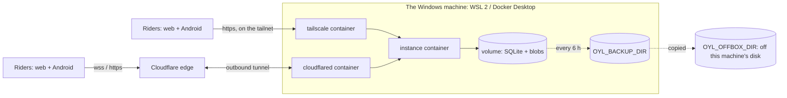

# Running the instance on a home Windows machine

The project's first instance runs on the owner's own Windows machine, in Docker
([#807](https://github.com/openzigs/onyourleft/issues/807), ADR 0037 D-8). Riders reach it in one of
two ways, and **neither needs a port opened on the router** (ADR 0079,
[#2790](https://github.com/openzigs/onyourleft/issues/2790)):

- **Your tailnet (no domain, the default).** The instance is served by `tailscale serve` at
  `https://<machine>.<tailnet>.ts.net`, and only devices on your tailnet can reach it
  ([#2805](https://github.com/openzigs/onyourleft/issues/2805), ADR 0079 D-2). It needs a free
  Tailscale account and nothing you pay for.
- **A Cloudflare tunnel (if you have a domain).** `cloudflared` serves a hostname on a domain you
  own on Cloudflare (ADR 0079 D-4). A domain is a yearly bill, so this is the option, never the
  requirement (D-1).

This guide is written so that **somebody who has never seen this repository** can follow it on
their own Windows machine, with **no git, no build and no Git Bash**: you download a release, fill
in one file, and start it ([#2786](https://github.com/openzigs/onyourleft/issues/2786)). Building
from a git checkout is still there, [for contributors](#for-contributors-deploying-a-git-checkout).
Everything after setup is in
[`operating-an-instance.md`](../operating-an-instance.md).



One machine runs **one** of the two, never both: an instance has one address, and every card,
passkey and device statement names it (ADR 0079 D-8). `deploy.sh` refuses both at once.

**What you need**: Windows 10 22H2 or 11 with virtualisation enabled; about 4 GB of memory to spare;
a Tailscale account (free), **or** a Cloudflare account (free) with a domain on it; and — for the
off-box backup, which the deploy requires — a drive that is not this machine's own disk, and **not
a removable USB stick** (see [Backups](#backups)).

## 1. Install Docker Desktop, with the WSL 2 backend

1. Install **WSL**: in an administrator PowerShell, `wsl --install`, and restart when it asks.
2. Install **Docker Desktop** from docker.com. In *Settings → General*, tick **Use the WSL 2 based
   engine** and **Start Docker Desktop when you sign in to your computer**.
3. In PowerShell: `docker version` answers with a client and a server, and
   `docker compose version` with a version.

Every command in this guide is typed in **PowerShell** unless it says otherwise.

**Docker Desktop is free for personal use** and for small organisations; a larger company needs a
paid Docker subscription. Two free alternatives under the Apache-2.0 licence run the same images:
**Podman Desktop** (podman-desktop.io) and **Rancher Desktop** (rancherdesktop.io, with its
`dockerd (moby)` engine, which gives you the same `docker` and `docker compose` commands). This
project tests on Docker Desktop and Docker Engine; with Podman, use `podman compose` where this guide
says `docker compose`, and check each step's answer yourself.

⚠️ **Docker Desktop starts when you SIGN IN, not when Windows boots.** After a reboot the instance
comes back only once somebody has signed in — set Windows to sign in automatically
(`netplwiz`), or accept that a reboot at night leaves the instance down until morning.

## 2. Download a release

1. Open the project's [releases page](https://github.com/openzigs/onyourleft/releases) and download
   **`onyourleft-instance-<version>.zip`** from the newest release.
2. Extract it into `C:\onyourleft`:

   ```powershell
   Expand-Archive "$HOME\Downloads\onyourleft-instance-<version>.zip" -DestinationPath C:\onyourleft -Force
   cd C:\onyourleft\onyourleft-instance
   ```

   The folder holds `compose.yaml`, `deploy.sh`, `instance.env.example`, `release.image`, and a
   `tailscale` folder with the two files `tailscale serve` reads on the tailnet (3a).
   `compose.yaml` names the instance's image **by its digest**, the line in `release.image`, so
   what Docker downloads is exactly the image this release was tested with.

**Check the image is ours (optional).** Every release's image is signed by this project's own
release workflow, keyless, with Sigstore's cosign: the signature is tied to that workflow's GitHub
identity and recorded in Sigstore's public log, and no key is stored anywhere. Install
[cosign](https://docs.sigstore.dev/cosign/system_config/installation/) (free, Apache-2.0; version 3
or later), then run this, with the digest from `release.image` in place of `sha256:…`:

```bash
cosign verify ghcr.io/openzigs/onyourleft-instance@sha256:… \
  --certificate-oidc-issuer https://token.actions.githubusercontent.com \
  --certificate-identity-regexp '^https://github\.com/openzigs/onyourleft/\.github/workflows/instance-image\.yml@refs/tags/v'
```

In PowerShell, type it on one line, or end each line with a backtick (`` ` ``) instead of `\`. It
needs no GitHub account. It prints the signature as JSON when the image is the project's, and fails
with `no matching signatures` when it is not. The release workflow runs this same command against
every image it publishes, and fails if it does not verify.

## 3. Choose how riders reach it

Do **one** of [3a](#3a-your-tailnet-no-domain) or [3b](#3b-a-cloudflare-tunnel-you-have-a-domain).

### 3a. Your tailnet (no domain)

1. **Make a Tailscale account** at tailscale.com (the Personal plan: free, up to 6 users, unlimited
   devices, and for non-commercial use only). In the admin console, **DNS**: turn on **MagicDNS** and
   **HTTPS Certificates**, and note your **tailnet name** (`your-tailnet.ts.net`).
2. **Set the tailnet's access rule** (*Access controls*) before the machine joins. It lets your own
   devices reach everything, and every other rider's device reach the instance's port and nothing
   else (ADR 0079 D-2). If you have never edited the policy, replace it with this; if you have, add
   these entries to yours:

   ```json
   {
     "tagOwners": { "tag:onyourleft": ["autogroup:owner"] },
     "grants": [
       { "src": ["autogroup:owner"], "dst": ["*"], "ip": ["*"] },
       {
         "src": ["autogroup:member", "autogroup:shared"],
         "dst": ["tag:onyourleft"],
         "ip": ["tcp:443"]
       }
     ]
   }
   ```

   The instance's container joins as `tag:onyourleft` (`compose.yaml` asks for it), so the second
   grant names it. A tagged machine's key does not expire, so the instance does not drop off the
   tailnet every 180 days.
3. **Name the machine.** It is `onyourleft` unless you set `TAILSCALE_HOSTNAME` in `.env`, so the
   instance's address is `https://onyourleft.your-tailnet.ts.net`. That is `OYL_INSTANCE_ORIGIN` in
   step 4. If the tailnet already has a machine of that name, Tailscale calls this one
   `onyourleft-1`; step 5 says how to check, and `deploy.sh` checks it for you.
4. **Put Tailscale on your own tablet now**, the one you ride with: install the Tailscale app on
   it, sign in with **your** Tailscale account, and leave it switched on. ⚠️ **Do this before step
   5a.** The tablet claims the instance by reaching its `https://` address, and that address exists
   only on the tailnet: a tablet that is not on it gets no answer, and the app can only say that the
   instance did not answer. Being on the same Wi-Fi is not enough, because plain `http://` on the
   home network is refused by the app and the instance alike (ADR 0079 D-6).
5. **How each rider joins**: invite them into your tailnet (*Users → Invite users*, each on their
   own Tailscale account; the free plan has 6 users), or share the machine with them (*Machines →
   onyourleft → Share*). Each rider installs the Tailscale app on their tablet or phone and signs in
   **as themselves**, and does so **before they scan an invite**: an invite scanned by a device that
   is not on the tailnet yet gets the same "did not answer". Sharing a *tagged* machine has not been
   tried here: if the console does not offer it, invite the rider.
   ⚠️ **Never sign a rider's device in to your own account**: that gives it your identity across the
   whole tailnet, past the access rule above.

**What to know before you choose it:**

- ⚠️ **The machine's name and your tailnet's name are public.** The certificate that makes
  `https://` work is a public one, and every public certificate's name is published in the
  Certificate Transparency logs. Choose `TAILSCALE_HOSTNAME` with that in mind: it is not your
  name or your street.
- **Who could still get in.** TLS ends on your machine, with a key Tailscale never sees, and
  Tailscale's relays carry only encrypted traffic. Tailscale, the company, could still add a device
  to your tailnet or obtain a certificate for your name, both by an active attack that would be
  logged (ADR 0079 D-2). **Tailnet Lock** (*Settings → Device management*) is the defence against
  the first. It is optional, and this deployment does not need it.
- **The admin pages work on the tailnet** at `https://onyourleft.your-tailnet.ts.net/admin`, with a
  passkey for that host, and the access rule keeps everybody else out.
- **A tailnet request is not the home network.** A rider at home on the tailnet is a rider like any
  other to the instance (ADR 0046's ruling of 2026-10-07).

**Measured on 2026-11-18** ([#2805](https://github.com/openzigs/onyourleft/issues/2805)): through
`tailscale serve`, a `text/event-stream` framed as the analysis write-up's stream arrived event by
event, one a second as they were written rather than together at the end, and a WebSocket stayed
open for the 2.5 minutes watched with a keepalive, and for 3.5 minutes with no traffic at all. `serve` writes the rider's tailnet address into `X-Forwarded-For` and **replaces** any
copy the rider sent, so the instance's rate limits count each rider by that address. Those figures
are from a local test tailnet over `http`, not from Tailscale's own service and certificates: check
yours with step 5's **Check it from a rider's device**.

#### Funnel: riders who will not join the tailnet (optional)

**Funnel** puts the same address on the public internet, so a rider needs no Tailscale app (ADR
0079 D-3). It is off unless you turn it on, and it changes what the instance is:

- ⚠️ **Anybody can reach it**, under a name anybody can find in the Certificate Transparency logs.
  No access rule is in front of it.
- **The admin pages are not served there.** While `OYL_INSTANCE_REMOTE_PATH=funnel`, every `/admin`
  path answers `404` to everybody, on the tailnet too. The admin pages on the server machine
  (`http://localhost:8788`) and the card on them are unchanged.
- **Funnel's bandwidth is limited** by Tailscale, by an amount it does not publish, so a room may
  not fit through it. Nobody has measured a room or a write-up through Funnel yet.

To turn it on: add the `funnel` attribute for the tag to the access rule (`"nodeAttrs": [{ "target":
["tag:onyourleft"], "attr": ["funnel"] }]`), set `OYL_INSTANCE_REMOTE_PATH=funnel` in `.env`, and
deploy again. `deploy.sh` then serves `tailscale/serve-funnel.json` in place of
`tailscale/serve-tailnet.json`. The address does not change, so no device needs a new card.

### 3b. A Cloudflare tunnel (you have a domain)

1. In the Cloudflare dashboard: **Zero Trust → Networks → Tunnels → Create a tunnel**, type
   **Cloudflared**. Name it (`onyourleft`).
2. It shows an install command containing a long token after `--token`. **Copy only the token.** Do
   not run the command: the tunnel runs as a container here.
3. **Public hostname**: a subdomain on your domain (`rides.example.org`), service type **HTTP**, URL
   **`instance:8787`** — the instance's name on the deployment's own Docker network.
4. Nothing else. WebSockets go through a tunnel with no extra setting.
5. **Optional: only your own address.** While you are the only rider, a WAF custom rule on the zone
   (*Security → WAF → Custom rules*, free on every plan) keeps everybody else out:
   `(http.host eq "rides.example.org" and not ip.src in {<your home IP>})`, action **Block**. Check it
   from a phone **on mobile data** — blocked — and from home — answers. If your home address changes,
   change the rule. It also blocks a phone hotspot, which matters in
   [Measuring the tunnel](#measuring-the-tunnel).

   **Once other riders use the instance**, the whole-host rule has to go, but the admin pages
   ([#2643](https://github.com/openzigs/onyourleft/issues/2643), ADR 0069 D-5) can keep it. Use
   this rule in its place, again with action **Block**:
   `(http.host eq "rides.example.org" and starts_with(http.request.uri.path, "/admin") and not ip.src in {<your home IP>})`.
   Riders reach the API from anywhere, and `/admin` answers only at home. ⚠️ **The instance cannot
   see this rule and does not rely on it.** The rule runs at Cloudflare's edge, so it is no defence
   against the edge itself (ADR 0069 D-3). The admin pages still need their own sign-in, a passkey
   for every change, and their own checks behind it.

   **If your home address changes**, the admin pages through the tunnel are blocked until you
   update the rule. The pages on the server machine (`http://localhost:8788`, in
   [docs/operating-an-instance.md](../operating-an-instance.md), "Admin pages on the server
   machine") and every passkey keep working. Optionally, `OYL_INSTANCE_ADMIN_ADDRESSES` in `.env`
   makes the instance itself refuse a tunnel sign-in from any other address. It is off by default,
   because with it on a changed address locks you out twice, at the rule and at the instance.

⚠️ **The token is a secret.** It goes in `.env` in step 4 and nowhere else — not a commit, not a
chat, not a screenshot. Anybody holding it can serve your hostname.

### Changing from one to the other later

The address changes, so **every rider's device must scan the instance's new card, and every admin
passkey made for the old address stops working** until you make one for the new address (ADR 0069
D-1, ADR 0079 D-8). The instance's identity and its data stay the same. Change
`OYL_INSTANCE_ORIGIN`, `COMPOSE_PROFILES`, `OYL_INSTANCE_REMOTE_PATH` and
`OYL_INSTANCE_CLIENT_ADDRESS_HEADER` together in `.env`, then deploy.

## 4. Fill in `.env`

```powershell
cd C:\onyourleft\onyourleft-instance
Copy-Item instance.env.example .env
notepad .env
```

Edit `.env`. **On a fresh install, leave the owner key, the secret and the registration mode empty**:
the setup page on this machine sets them up after the deploy, in step 5a, with no copying of keys.

| Variable | Set it to |
|---|---|
| `COMPOSE_PROFILES` | `tailscale` for 3a, `cloudflare` for 3b (add `history` or `analysis` with a comma if you use those) |
| `OYL_INSTANCE_REMOTE_PATH` | `tailnet` for 3a (or `funnel`, if you turned it on), `cloudflare` for 3b |
| `OYL_INSTANCE_CLIENT_ADDRESS_HEADER` | `x-forwarded-for` for 3a; `cf-connecting-ip` for 3b, which is also what empty means. The instance refuses to start with the other path's |
| `OYL_INSTANCE_ORIGIN` | `https://` and the address from step 3: `https://onyourleft.your-tailnet.ts.net` with **your** tailnet's name in place of `your-tailnet`, or the tunnel's public hostname. ⚠️ The template's line is an example, not a default: while it still says `your-tailnet`, the instance serves no account and makes no keys, and the setup page (step 5a) only says to set this ([#2855](https://github.com/openzigs/onyourleft/issues/2855)) |
| `OYL_INSTANCE_REGISTRATION` | **leave it empty** on a fresh install, and choose on the setup page (step 5a), which wins over this line. Otherwise `approval` (you approve each new account; the default, and what an empty value means), `invite`, `open`, or `closed` — see [`docs/moderation.md`](../moderation.md). Your own device registers active in every mode once it is the owner. ⚠️ `closed` turns away **your other** devices too: the app says the instance is not taking new riders. Link them to your account from the app instead, or approve them |
| `OYL_INSTANCE_OWNER_KEY` | **leave it empty** on a fresh install: you claim the instance with your tablet on the setup page (step 5a). The expert path: your device key, which the app shows — then the instance is yours from its first start and the setup page never opens |
| `OYL_INSTANCE_DEPUTY_KEY` | leave it **empty**. An instance has one moderator ([`docs/moderation.md`](../moderation.md)); this names a second only if you want one |
| `CLOUDFLARE_TUNNEL_TOKEN` | 3b only: the token from step 3b |
| `TAILSCALE_HOSTNAME` | 3a only, optional: the machine's name on the tailnet, `onyourleft` when empty. It is public (step 3a) |
| `TAILSCALE_AUTH_KEY` | 3a only, optional: empty, and the first deploy prints a sign-in link instead. A key from *Settings → Keys* (tagged `tag:onyourleft`) signs the machine in by itself; it is a secret, like the tunnel token |
| `OYL_INSTANCE_SECRET_KEY` | **leave it empty.** The instance makes it on its first start in the `secrets/` folder beside `compose.yaml`, owner-only, and reads it there on every later start (#2781). Setting it yourself with `openssl rand -base64 32` is optional, for an existing install. It is what a hosted model key and the instance's own keys are encrypted under, so download the **emergency kit** on the setup page (step 5a), or later from the admin pages on this machine, and keep it away from both backup folders ([`operating-an-instance.md`](../operating-an-instance.md#the-instances-secrets)) |
| `OYL_INSTANCE_NAME` | optional: the name the app shows for this instance, at most 64 characters |
| `OYL_BACKUP_DIR` | a folder on this machine for snapshots, e.g. `C:/onyourleft/backups` |
| `OYL_OFFBOX_DIR` | **required — the deploy refuses to start without it.** A folder that is **not** on this machine's own disk. ⚠️ On Windows **a USB stick does not work here**: read [Backups](#backups) first |
| `OYL_INSTANCE_WS_COMPRESSION` | `off` unless your upload is the limit — see [Compression](#compression-and-your-upload) |

No release contains a `.env`, so extracting the next release over this folder never overwrites it.

**The rider's address, and why `compose.yaml` fixes the proxies' addresses.** Every connection
reaches the instance from `cloudflared` or from the `tailscale` container, so the per-address rate
limits read the rider's own address from the header that proxy writes
(`OYL_INSTANCE_CLIENT_ADDRESS_HEADER`): `cf-connecting-ip` behind Cloudflare, `x-forwarded-for`
behind `tailscale serve`. The instance believes that header only from a proxy it trusts — loopback,
or an address in `OYL_INSTANCE_TRUSTED_PROXIES` — so `compose.yaml` gives `cloudflared` the fixed
address `172.30.87.10` on the project's own network, and `172.30.88.10` on `tunnel_metrics`, the
internal network only it and the instance share for the tunnel's readiness (#2604), gives
`tailscale` `172.30.87.11`, and names exactly those three addresses. You do not set them in `.env`.
The same list is what makes the admin pages' loopback listener close a connection from either proxy
unread (ADR 0069 D-5). If `172.30.87.0/24` or `172.30.88.0/24` is already in use on this machine,
change that subnet, the proxies' addresses on it and `OYL_INSTANCE_TRUSTED_PROXIES` in
`compose.yaml` together; for `172.30.88.0/24`, also the `--metrics` address in the tunnel's command
and `OYL_INSTANCE_TUNNEL_READY_URL` in `.env`. Anything else on that network, or a port published
for local debugging, is counted as itself, whatever header it sends.

## 5. Start it

**On Linux only, one command first.** The release's folder holds an empty `secrets` folder that only
its owner can open: the instance keeps its secret key and the setup code there. Inside its container
the instance runs as user 1000, so on Linux that user has to own the folder, whoever extracted the
zip ([#2818](https://github.com/openzigs/onyourleft/issues/2818)):

```bash
cd /path/to/onyourleft-instance
sudo chown 1000 secrets
```

**Windows and macOS skip it**: Docker Desktop maps the folder's owner itself, and on macOS the
command would hand the folder to a user that is not you. A Linux machine that skips it, where your
own user is not 1000 (`id -u` says), fails its first start with `OYL_INSTANCE_SECRET_KEY is not set,
and its file could not be made in /run/secrets/onyourleft`. After it, a user who is not 1000 reads
the setup code in step 5a with `sudo cat secrets/setup-code`. If there is no `secrets` folder — a git
checkout has none — make it first, with `mkdir -m 700 secrets`: left to Docker, a missing one is made
owned by root, which the instance cannot write either.

```powershell
cd C:\onyourleft\onyourleft-instance
docker compose up -d --wait instance
docker compose up -d
```

The first command downloads the image, runs the database's migrate step to completion, then starts
the instance and waits until it is healthy: it ends with the instance `Healthy`, or names what
failed. The second starts the remote path `COMPOSE_PROFILES` names (`tailscale` or `tunnel`) and the
scheduled backup beside it.

**Where this machine has a bash** (macOS, Linux, WSL, or Git Bash on Windows), `bash deploy.sh` in
this folder does the same in one command, and checks more: before anything starts it refuses a
`.env` that turns on both remote paths or lacks a setting the one it names needs, and it waits
until `/ready` says ready. It pulls the image `release.image` names and needs no git.

**On the tailnet (3a)** Tailscale has to be signed in once. With no `TAILSCALE_AUTH_KEY`, the
`tailscale` container prints a sign-in link: run `docker compose logs tailscale`, open the
`https://login.tailscale.com/…` link it shows, and sign in as yourself. Then check that the name
`tailscale serve` answers on is the one in `OYL_INSTANCE_ORIGIN`, because every card the instance
draws names that address:

```powershell
docker compose exec tailscale tailscale status --json --peers=false
```

`Self` → `DNSName` is the machine's name, with a dot at the end (`onyourleft.your-tailnet.ts.net.`).
If it is not the address in `OYL_INSTANCE_ORIGIN` — Tailscale calls the machine `onyourleft-1` when
the tailnet already has an `onyourleft` — set `OYL_INSTANCE_ORIGIN` to `https://` and that name,
without the final dot, and run `docker compose up -d instance`. `bash deploy.sh` does both for you:
it prints the link while it waits, then compares the origin the running instance has with that name,
and if they differ says both and exits 1.

**Check it from a rider's device** (on the tailnet for 3a, on mobile data for 3b):
`https://onyourleft.your-tailnet.ts.net/health` or `https://rides.example.org/health` answers
`{"status":"ok",…}` and `/ready` answers `{"status":"ready",…}`.

## 5a. Set it up on this machine

On this machine, open **`http://localhost:8788/setup`** in a browser (type `localhost`, not
`127.0.0.1`). The page asks for the **setup code**: open the file `setup-code` in the `secrets` folder
beside `compose.yaml` (`apps/instance/deploy/home/secrets/setup-code`) and type the first line. A code
works once, for ten minutes; if it has run out, run `docker compose restart instance` in that folder
and open the file again. The code is never printed in `docker compose logs`, which only say where it
is.

If the page says **Set this server's address first** and shows no box for the code,
`OYL_INSTANCE_ORIGIN` in `.env` is still the template's example: set it (step 4), run
`docker compose up -d instance`, and open the page again. Nothing was made for the example address,
so no device needs a new card afterwards.

Then follow the page, step by step. You can leave and come back at any time; it resumes where you
were.

1. **Claim it with your tablet.** ⚠️ **First, the tablet must be able to reach the instance's
   address**: on the tailnet (3a), Tailscale installed, signed in as you and switched on (step 3a.4);
   with a tunnel (3b), online. The page names the address the tablet will use and says this before it
   shows the code. To check, open that address with `/health` on the end in the tablet's browser: it
   answers `{"status":"ok",…}`. With a tunnel the page also says whether the tunnel is connected,
   checked from this machine; it cannot see your tailnet, so on 3a it says nothing of the kind.
   Then press *Show the claim code*, open On Your Left on the tablet you ride
   with, go to *Instance* and scan the code **with the app's own scanner**, then press *I’ve scanned
   it* on the page. The tablet shows six digits; if the page shows the same six, press *Yes*. The page
   says your tablet now owns the server. If the app says the instance **did not answer**, the tablet
   cannot reach the address yet: the app names the address it tried and the likely cause, and the
   code is not spent, so scan it again once the tablet is on the network.
2. **A passkey** for the admin pages: optional. You can skip it and add one later from the admin
   pages.
3. **The emergency kit**: download it once and keep it in a password manager or on paper, **never
   beside the backups**. After setup it can be downloaded again from the admin pages on this machine,
   once you have added a passkey there.
4. **Backups**: press *Back up now*, then *Check now* until the backup has run. The page says
   whether the snapshot reached **both** folders: the one on this computer and the copy kept
   elsewhere. The folders themselves are the `OYL_BACKUP_DIR` and `OYL_OFFBOX_DIR` lines in `.env`
   (step 4): to change one, edit that line and deploy again. ⚠️ On Windows the copy kept elsewhere
   cannot be on a USB stick ([Backups](#backups)).
5. **Who may join**: *Anyone can join*, *I approve each new rider*, *Only people I invite* or *Nobody
   new*, then *Save and go to the next step*. You can change it later with
   `docker compose exec instance node src/operator/cli.ts registration set <mode>`.
6. **Invite a rider**: one invite, as a code a rider scans in the app. If the page says your tablet
   has not signed in yet, connect to the instance from the app on the tablet first. ⚠️ **The rider's
   phone or tablet needs the same way in first**: on the tailnet, the Tailscale app, signed in as
   **themselves** and let onto your tailnet (step 3a.5), before they scan. The page says so, and so
   does the app's own *Invite a rider*, under *Moderation*, for every invite you make later.
7. **Finish.** The page lists where the server stands, and the setup page closes for good.

Until the tablet has claimed the instance, nobody can make an account on it. **The expert path**
still works: with `OYL_INSTANCE_OWNER_KEY` set in `.env` the setup page never opens, and the
[operating guide](../operating-an-instance.md#the-first-run-setup-page) has the commands behind each
step.

## 6. A room to ride in

Until riders can make rooms in the app ([#784](https://github.com/openzigs/onyourleft/issues/784),
[#785](https://github.com/openzigs/onyourleft/issues/785)), the operator opens one:

```powershell
cd C:\onyourleft\onyourleft-instance
docker compose run --rm --no-deps --entrypoint node migrate src/operator/cli.ts room-open saturday-ride --kind ride --length 40000
```

## Public rooms: the owner's check

Public rooms ([#788](https://github.com/openzigs/onyourleft/issues/788)) are rooms any adult rider on
the instance can find and join. They are **off** here: `.env` says `OYL_INSTANCE_PUBLIC_ROOMS=off`,
and an instance that sets nothing has them off too. Turning them on for the project's instance is the
owner's step, and only after this check (ruling Q5, 2026-09-28):

1. **The UK Online Safety Act and EU DSA issues that #778 filed are closed as done** — closed as
   completed, not closed as not planned:

   ```bash
   gh issue view 886 --json state,stateReason   # the OSA illegal-content and children's access assessments
   gh issue view 887 --json state,stateReason   # the DSA notice-and-action mechanism
   ```

   Both must answer `"state":"CLOSED"` and `"stateReason":"COMPLETED"`. Anything else, and public
   rooms stay off.
2. **The drafts in [`docs/moderation.md`](../moderation.md) → "Before you open your instance to the
   public" are signed off by the owner.**
3. **`OYL_INSTANCE_CONTACT_EMAIL` and `OYL_INSTANCE_ACCOUNTABLE_PERSON` are set.** The instance
   refuses to start with public rooms on without both.

Then set `OYL_INSTANCE_PUBLIC_ROOMS=on` in `.env` and deploy again (step 5). To switch them off —
while you are away, say — set it back to `off` and deploy.

What a rider then gets: an eligible adult (confirmed 18 or over, and [`docs/moderation.md`](../moderation.md)
→ "Public rooms: who may join") can list a room they make, at most 3 a day, and see and join the
others, listed by when each starts and then when it was made, and in no other order.

## The history index (optional)

The post-ride write-up can look back at a rider's own history — their earlier write-ups, ride
summaries, goals, notes and documents — when the instance keeps a searchable index of it
([ADR 0040](../adr/0040-a-history-index-on-the-riders-instance.md), #835). The index is worked out
by an embedding model **on this machine**: nothing is sent anywhere else to build it. Without it
the instance works exactly as before, and a write-up is written without history.

1. In `.env`: `COMPOSE_PROFILES=history` and `OYL_INSTANCE_EMBEDDING_URL=http://ollama:11434`.
2. Start the model server and pull the model once:

   ```powershell
   cd C:\onyourleft\onyourleft-instance
   docker compose up -d ollama
   docker compose exec ollama ollama pull nomic-embed-text
   docker compose up -d instance
   ```

   `nomic-embed-text` (`nomic-ai/nomic-embed-text-v1.5`, Apache-2.0, 274 MB) is the default. You may
   name another in `OYL_INSTANCE_EMBEDDING_MODEL`; changing it re-embeds everything, and until that
   has finished a write-up gets less history, never a mixture of two models'.

3. `docker compose logs instance` says `"event":"history-index","state":"on"`. If it says `off`,
   the `code` says why, and the instance's standard error has the whole sentence.

⚠️ **Never publish Ollama's port and never point the tunnel at it.** Its API has **no
authentication**: a published port is an open model server for anybody who can reach it. The
compose file publishes none, and the instance is the only thing that talks to it, by its service
name over this project's own network. The instance also refuses an embedding address that is not
this machine or its private network, and checks where the name resolved to on every request.

**A GPU is optional.** On the processor, four cores embed about six passages a second, measured on
an Apple M4 Pro in Docker — enough for a rider's history, but ⚠️ **not measured on a Windows PC**
([#835](https://github.com/openzigs/onyourleft/issues/835) owes that figure). Docker Desktop passes
through an NVIDIA GPU only, on the WSL 2 backend: add to the `ollama` service

```yaml
    deploy:
      resources:
        reservations:
          devices:
            - driver: nvidia
              count: all
              capabilities: [gpu]
```

and check it with `docker run --rm -it --gpus=all nvcr.io/nvidia/k8s/cuda-sample:nbody nbody -gpu
-benchmark` ([Docker's GPU guide](https://docs.docker.com/desktop/features/gpu/)).

## A model server on the machine itself, not in Compose

The analysis model can run in the Compose `ollama` service
([`operating-an-instance.md` → Analysis model](../operating-an-instance.md#analysis-model)), which
Docker restarts with everything else. Both of the project's own machines run it **installed on the
machine itself** instead, for the GPU ([#1235](https://github.com/openzigs/onyourleft/issues/1235)):
Ollama for Windows on the owner's Windows box, and Ollama from Homebrew on the Mac. Then starting
it is your job, not Docker's, and **after a reboot the instance comes back by itself and the model
server may not**: every write-up fails until somebody starts it
([#1272](https://github.com/openzigs/onyourleft/issues/1272)). Four things make it come back.

### It listens on loopback only

⚠️ **Ollama's API has no authentication.** Leave `OLLAMA_HOST` unset, and Ollama listens on
`127.0.0.1:11434`, which Docker Desktop still reaches from a container (the address, below). Never
set `OLLAMA_HOST=0.0.0.0`: that is an open model server for every device on every network the
machine joins, the home Wi-Fi included. If you must listen elsewhere, listen on a private address
only, and block the port in the firewall for every other machine. Never point the tunnel at it.

### It starts with the machine

- **Windows.** Ollama for Windows registers itself as a login item when it is installed: check
  that *Task Manager → Startup apps → Ollama* says **Enabled**, and start it from the Start menu,
  not as `ollama serve` in a terminal, which ends when the terminal does. That terminal is how the
  owner's box came to have no model after a reboot.
- **macOS.** `brew services start ollama` registers a LaunchAgent
  (`~/Library/LaunchAgents/sh.brew.ollama.plist`, with `RunAtLoad` and `KeepAlive`): it starts
  when you sign in, and again if it stops. `brew services list` says `started`. The Ollama app from
  ollama.com registers itself as a login item instead, which also starts at sign-in.

Either way it starts at **sign-in**, as Docker Desktop does (step 1), so automatic sign-in covers
both: `netplwiz` on Windows; *System Settings → Users & Groups → Automatically log in as* on a Mac,
which FileVault does not allow. A model server that started before sign-in would gain nothing,
because the instance cannot start before Docker Desktop.

**Check it after a reboot**, before a rider finds out: `curl http://127.0.0.1:11434/api/version`
on the machine answers `{"version":"…"}`, and so does the instance's address for it (the next
part) from inside Docker:

```bash
docker run --rm alpine wget -q -T 3 -O - http://192.168.65.254:11434/api/version
```

### The address: the private IP that `host.docker.internal` names, not the name

Docker Desktop gives every container a name for the machine it runs on, `host.docker.internal`,
and forwards it to the machine's own loopback. **The instance refuses that name.** A model address
must be loopback, `localhost`, a private address, or a name with no dot in it, such as a Compose
service (`apps/instance/src/history/address.ts`, ADR 0040 D-6), and this name has two. The instance
still starts, with analysis off: its log says `"event":"analysis-model","state":"off","code":"not-local"`,
and its standard error

```
instance: analysis is off: OYL_INSTANCE_ANALYSIS_MODEL_URL was refused because it is a name with a dot in it, which is not a Compose service name, localhost or a private address: the analysis model must be on this machine or its private network (ADR 0046 D-9, ADR 0040 D-6).
```

Use the address the name stands for. Ask Docker:

```bash
docker run --rm alpine getent hosts host.docker.internal
```

On the project's Mac (Docker Engine 29.5.3, 2026-10-14) it printed `192.168.65.254`, and Ollama,
listening on loopback only, answered there from a container. So in `.env`:

```
OYL_INSTANCE_ANALYSIS_MODEL_URL=http://192.168.65.254:11434/v1
OYL_INSTANCE_ANALYSIS_MODEL=<the model you pulled>
```

and `COMPOSE_PROFILES` without `analysis`, since the Compose `ollama` is not used for it. Then
`docker compose up -d instance`.

**If the address changes** — after a Docker Desktop update, or a change to its network under
*Settings → Resources → Network* — every write-up fails as if the model were down (below). Run the
`getent` line again, put the new address in `.env`, and `docker compose up -d instance`. Do not
replace it with the machine's address on the home network: Ollama does not listen there, and must
not.

Changing the instance to accept `host.docker.internal` would change a security rule, and is not
done here.

### State the context length

Ollama's default context follows the GPU memory it sees: 4 096 tokens under 24 GiB, 32 768 from 24
to 48 GiB, more above ([Ollama's documentation](https://docs.ollama.com/context-length)). On the
Windows box the default was 32 768, and at that length a larger model put 37 % of itself on the
processor (#1235). So state it, and check that the model fits the GPU with it. The project's runs
used 4 096 (spike 0023); read
[`operating-an-instance.md` → Analysis model](../operating-an-instance.md#analysis-model) before
choosing.

- **Windows**: quit Ollama from the tray; in Settings, search for *environment variables* and
  choose *Edit environment variables for your account*; add `OLLAMA_CONTEXT_LENGTH`; and start
  Ollama again. A variable of your account lasts across reboots.
- **macOS, Homebrew**: `brew services` writes `sh.brew.ollama.plist` itself, so a variable added to
  it does not last. Give the length to the model instead, which works on any platform: a file named
  `Modelfile` holding

  ```
  FROM <the model you pulled>
  PARAMETER num_ctx 4096
  ```

  then `ollama create <a new name> -f Modelfile`, and that new name in
  `OYL_INSTANCE_ANALYSIS_MODEL`. It copies no weights. On the Mac (Ollama 0.30.5, 2026-10-14) a
  model made this way with `num_ctx 8192`, asked through the `/v1` address the instance uses, loaded
  at 8 192, where its source model loaded at 4 096.

Check it with `ollama ps` while a write-up runs: `CONTEXT` is the length, and `PROCESSOR` should
say `100% GPU`.

### What a rider sees while it is down

The instance does not ask the model server anything at start, so with it down the instance still
logs `"event":"analysis-model","state":"on"` and `/ready` says ready. The first sign is a job. Each
write-up asked for fails with the failure `model-unreachable`; the instance logs
`"event":"analysis-job","state":"failed","code":"model-unreachable"`, and the rider's app says:

> Your instance could not reach its model, so nothing was kept. Check that the model server is
> running, then try again.

A re-plan asked for during a workout fails the same way, and the Ride screen says its one line for
every failure: *"No re-plan could be asked for just now. The workout carries on as planned."* The
ride itself is not touched. A write-up is not tried again by itself: the rider asks again once the
model is back.

## Compression and your upload

A home connection's **upload** is the first thing a room runs out of — before the CPU and before
memory ([ADR 0037](../adr/0037-instance-runtime-hosting-and-transport.md) D-8.3). One 50-rider room
sends:

| | Upload per 50-rider room | Rooms on a 10 Mbit/s upload |
|---|--:|--:|
| Compression **off** (the default) | ≈ 0.36 Mbit/s | about 27 |
| Compression **on** | ≈ 0.18 Mbit/s | about 55 |

That is arithmetic from spike 0013 §5, before headroom and before the tunnel's own framing — not a
measurement of your line ([#792](https://github.com/openzigs/onyourleft/issues/792) measures it).
Compression roughly **doubles the memory** each rider costs, so turn it on
(`OYL_INSTANCE_WS_COMPRESSION=on`, then `docker compose up -d instance`) only when the upload binds
first. Measure your upload with any speed test.

## Sleep, updates and reboots

**While rooms are open, stop Windows sleeping**: *Settings → System → Power → Screen and sleep →
When plugged in, put my device to sleep after: Never*. A sleeping machine answers nothing.

What happens when it sleeps, reboots, or loses its connection anyway:

| Event | What a rider sees | What survives |
|---|---|---|
| **Asleep** | their app cannot reach the instance, and must say *"The instance is not reachable"* in words — the client's half, [#782](https://github.com/openzigs/onyourleft/issues/782), not built yet; **their ride goes on recording on their own device** | everything on the instance, untouched |
| **A Windows update reboots it mid-ride** | the room closes; on reconnecting, a **race** says `room-closed` — it does not resume — and a **group ride** opens again, empty | every result already final (a rider who had crossed the line); the database and blobs; nothing about the race in progress |
| **Back on**, after sign-in (step 1) | the instance is back by itself: Docker restarts every container (`restart: unless-stopped`). A model server on the machine itself comes back only if it starts at sign-in — see [A model server on the machine itself](#a-model-server-on-the-machine-itself-not-in-compose) | — |
| **Cloudflare restarts its servers** (it says it may, daily) | a dropped socket; the app rejoins at once, into the same seat and place (ADR 0028 D-2 rule 1) | the room: the rider was coasted at 0 W while they were away |

To keep a Windows update from rebooting during an evening's rides, set **active hours**
(*Settings → Windows Update → Advanced options*) to cover them.

Stopping it on purpose: `cd C:\onyourleft\onyourleft-instance`, then `docker compose stop`. Riders are told the
server is stopping (close code 1001) and results already final are written first.

## Updating

Download the new release's zip and extract it **over the same folder**: it replaces the release's files
and leaves your `.env`, your `secrets` folder and the record of what is deployed. Then, where this
machine has a bash (macOS, Linux, WSL, or Git Bash on Windows), one command does the rest:

```bash
cd /path/to/onyourleft-instance
bash deploy.sh
```

It takes a snapshot of the data first, starts the new image (the database is migrated as its own
step before it starts), and waits until `/ready` says ready. **A new image that does not become
ready is replaced by the previous one, with the snapshot restored**, and the command exits 1. It
needs no git and builds nothing. To go back by hand later: `bash deploy.sh --rollback`. The release
workflow proves this for every image it publishes: it deploys an image that never becomes ready and
requires the published digest to be the one running afterwards.

**On Windows with no bash**, the same steps by hand:

```powershell
cd C:\onyourleft\onyourleft-instance
docker compose run --rm --no-deps --entrypoint node backup src/operator/cli.ts backup /backups/pre-deploy --keep 3
Expand-Archive "$HOME\Downloads\onyourleft-instance-<new version>.zip" -DestinationPath C:\onyourleft -Force
docker compose up -d --wait instance
docker compose up -d
```

If `docker compose up -d --wait instance` does not come back healthy, **nothing puts the previous
version back for you**: extract the previous release's zip over the folder again, restore the
snapshot the first command printed ([Restore](../operating-an-instance.md#restore)), and run the
last two commands again. A launcher that does this on Windows without a terminal is
[#2788](https://github.com/openzigs/onyourleft/issues/2788).

**A `.env` from before the tunnel was a profile** (#2805) has `CLOUDFLARE_TUNNEL_TOKEN` and no
`COMPOSE_PROFILES`. `deploy.sh` still starts its tunnel, and says to add `cloudflare` to
`COMPOSE_PROFILES`. Do that before you update, so that a `docker compose up` by hand — the Windows
steps above — starts it too.

## Backups

The `backup` service takes an online snapshot every six hours into `OYL_BACKUP_DIR`, copies it to
`OYL_OFFBOX_DIR`, and keeps the newest fourteen of each (`OYL_BACKUP_INTERVAL_SECONDS`,
`OYL_BACKUP_KEEP`). A copy that cannot be written is recorded as `failed` and says so in
`docker compose logs backup`; the snapshot on the box is kept. Each run is recorded in the database,
and the owner can ask for a snapshot from the app's Operate area, which the service takes within
30 seconds — see [Backup](../operating-an-instance.md#backup).

⚠️ **No backup may be older than 30 days** (#1381): a backup holds what the instance has since erased,
and the privacy policy tells riders so. The defaults (fourteen, six hours apart) keep 3.5 days. If you
change either number, keep `OYL_BACKUP_KEEP` × `OYL_BACKUP_INTERVAL_SECONDS` under 2 592 000 seconds;
[Backup](../operating-an-instance.md#backup) lists the other copies to count.

⚠️ **On Windows, a USB stick cannot be `OYL_OFFBOX_DIR`.** Docker Desktop reaches Windows drives
through WSL, and WSL does not mount a removable drive by itself, not even after `wsl --shutdown`
with the stick plugged in. Docker still accepts `E:/onyourleft-backups`, but it gives the container
an empty folder inside its own VM instead: every copy fails with *Permission denied*, and nothing
reaches the stick. Measured on the project's Windows box, 2026-10-09
([#807](https://github.com/openzigs/onyourleft/issues/807)). Check yours before you trust it:

```powershell
docker run --rm -v "E:/onyourleft-backups:/t" alpine sh -c 'mount | grep " /t "'
```

A Windows drive shows as `9p` with `aname=drvfs`. `ext4` means Docker made the folder in its VM, so
the copy is not on that drive. Until there is a supported way for a removable drive, use a drive
that WSL does mount.

**Restoring on another machine** — the drill worth doing once, before it is needed:

1. On the second machine, steps 1, 2 and 4 of this guide.
2. Copy one `snapshot-…` folder from the off-box drive to it.
3. `cd C:\onyourleft\onyourleft-instance`, then restore into the deployment's volume and check it:

   ```powershell
   docker compose run --rm --no-deps -v "C:/path/to/snapshot-…:/restore:ro" --entrypoint node migrate src/operator/cli.ts restore /restore
   docker compose run --rm --no-deps --entrypoint node migrate src/operator/cli.ts verify
   ```

4. Compare `verify`'s row and blob counts with the `manifest.json` in the snapshot folder, and time
   it.

⚠️ **If the second machine already runs an instance, its stack is project `onyourleft` too**, and
the commands above would restore into ITS volume. Give the drill a project of its own: add
`-p onyourleft-drill` after every `docker compose`, and remove it afterwards with
`docker compose -p onyourleft-drill down -v`.

## Measuring the tunnel

[#807](https://github.com/openzigs/onyourleft/issues/807) asks for a measurement, not a number from a
forum. From a **different** machine (a laptop on a phone's hotspot is ideal — but if you set up
step 3's address rule, a hotspot is blocked: use another machine on your home network), with the
repository and Node 26:

```bash
cd apps/instance
# 1. The tunnel's idle timeout: open a race lobby, and turn the instance's own ping off for it.
#    (In .env on the box: OYL_INSTANCE_PING_INTERVAL_MS=0, then `docker compose up -d instance`.)
node tools/tunnel-soak.ts --url https://rides.example.org --room lobby-probe --idle-probe --minutes 5
#    Then remove OYL_INSTANCE_PING_INTERVAL_MS from .env and `docker compose up -d instance` again.

# 2. Thirty minutes, two riders, one room, rejoining whenever a socket drops.
node tools/tunnel-soak.ts --url https://rides.example.org --room tunnel-soak --minutes 30
```

The rooms first: `room-open lobby-probe --kind race --length 1000` and
`room-open tunnel-soak --kind ride --length 100000 --countdown 0`, and `OYL_INSTANCE_REGISTRATION=open`
while it runs (it signs its riders up). The first prints how long an idle socket lived; the second
the disconnects, each rejoin's time and the longest silence. The ride's keepalive (30 s, ADR 0037
D-8.1) and the instance's ping (25 s) must both be shorter than the idle timeout the first printed.
Close registration again afterwards.

On the project's Windows box (2026-10-09, run from a Mac on the same home network), the idle socket
lived **125 s**, and the 30-minute run had no disconnects, 1,799 frames for each rider and a
longest silence of 1.3 s. Those are one line's figures, not yours.

## For contributors: deploying a git checkout

The steps above run a published release. To run a change that is not released yet, deploy a
checkout instead: the same `compose.yaml` and `deploy.sh`, in `apps/instance/deploy/home/`, with the
image **built** from the checkout and tagged with its commit. It needs git and, on Windows, Git Bash.

1. Install **Git for Windows** (it brings Git Bash, which `deploy.sh` runs in), then in Git Bash
   clone the repository and make the `.env`, as step 4 says:

   ```bash
   git clone https://github.com/openzigs/onyourleft.git
   cd onyourleft/apps/instance/deploy/home
   cp instance.env.example .env
   ```

2. Deploy — one command, from anywhere inside the checkout:

   ```bash
   bash apps/instance/deploy/home/deploy.sh
   ```

   It checks that `.env` names one remote path and the settings it needs, builds the image from
   this checkout (tagged with the commit), takes a snapshot, runs the database's migrate step,
   starts the instance, waits until `/ready` says ready, then starts the remote path (`tailscale`
   or `tunnel`) and the scheduled backup, and prints how long it took. On the tailnet it then does
   step 5's sign-in and origin check itself. If the new build never becomes ready it puts the
   previous one back by itself, with the data as it was — see
   [`operating-an-instance.md` → Upgrading](../operating-an-instance.md#upgrading). To update:
   `git pull`, then the same command. To go back by hand:
   `bash apps/instance/deploy/home/deploy.sh --rollback`. `.env` is ignored by git, so `git pull`
   never overwrites it and never uploads it.

⚠️ **Git Bash rewrites anything that looks like a path** before `docker` sees it, so a path INSIDE
a container (`/backups`, `/restore`) arrives as `C:/Program Files/Git/backups`, and the command
fails with nothing but `the command failed (Error)`. `deploy.sh` turns this off itself. When you type
a command from this guide in Git Bash and it names a path inside a container, start it with
`MSYS_NO_PATHCONV=1`. PowerShell does not rewrite paths.

## What is not here

- **Metrics for the public.** `OYL_INSTANCE_METRICS` is off; turned on, `/metrics` answers only a
  request carrying `OYL_INSTANCE_METRICS_TOKEN`, which stays in the box's `.env`.
- **A second instance while one updates.** One box, one instance: an update closes rooms for the
  seconds it takes. A managed deploy with no gap is [#790](https://github.com/openzigs/onyourleft/issues/790).
- **The Durable Object adapter.** Built and not deployed (the owner's Q3/Q6).
