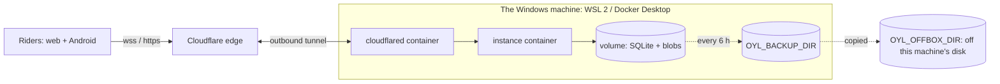

# Running the instance on a home Windows machine

The project's first instance runs on the owner's own Windows machine, in Docker, reached from the
internet **only** through a Cloudflare Tunnel
([#807](https://github.com/openzigs/onyourleft/issues/807), ADR 0037 D-8). This guide is written so
that **somebody who has never seen this repository** can follow it on their own Windows machine.
Everything after setup is in [`operating-an-instance.md`](../operating-an-instance.md).



**What you need**: Windows 10 22H2 or 11 with virtualisation enabled; about 4 GB of memory to spare;
a Cloudflare account (free) with a domain on it; and — for the off-box backup, which the deploy
requires — a drive that is not this machine's own disk, and **not a removable USB stick** (see
[Backups](#backups)). **The router opens no port**: `cloudflared` dials out.

## 1. Install Docker Desktop, with the WSL 2 backend

1. Install **WSL**: in an administrator PowerShell, `wsl --install`, and restart when it asks.
2. Install **Docker Desktop** from docker.com. In *Settings → General*, tick **Use the WSL 2 based
   engine** and **Start Docker Desktop when you sign in to your computer**.
3. Install **Git for Windows** (it brings Git Bash, which `deploy.sh` runs in).
4. In Git Bash: `docker version` answers with a client and a server, and
   `docker compose version` with a version.

⚠️ **Git Bash rewrites anything that looks like a path** before `docker` sees it, so a path INSIDE
a container (`/backups`, `/restore`) arrives as `C:/Program Files/Git/backups`, and the command
fails with nothing but `the command failed (Error)`. `deploy.sh` turns this off itself. When you type
a command from this guide that names a path inside a container, start it with
`MSYS_NO_PATHCONV=1` (the restore drill below does).

⚠️ **Docker Desktop starts when you SIGN IN, not when Windows boots.** After a reboot the instance
comes back only once somebody has signed in — set Windows to sign in automatically
(`netplwiz`), or accept that a reboot at night leaves the instance down until morning.

## 2. Get the code

```bash
git clone https://github.com/openzigs/onyourleft.git
cd onyourleft
```

## 3. Create the tunnel and its public hostname

1. In the Cloudflare dashboard: **Zero Trust → Networks → Tunnels → Create a tunnel**, type
   **Cloudflared**. Name it (`onyourleft`).
2. It shows an install command containing a long token after `--token`. **Copy only the token.** Do
   not run the command: the tunnel runs as a container here.
3. **Public hostname**: a subdomain on your domain (`rides.example.org`), service type **HTTP**, URL
   **`instance:8787`** — the instance's name on the deployment's own Docker network.
4. Nothing else. WebSockets go through a tunnel with no extra setting.
5. **Optional: only your own address.** While you are the only rider, a WAF custom rule on the zone
   (*Security → WAF → Custom rules*, free on every plan) keeps everybody else out:
   `(http.host eq "rides.example.org" and not ip.src in {<your home IP>})`, action **Block**. Check it
   from a phone **on mobile data** — blocked — and from home — answers. If your home address changes,
   change the rule. It also blocks a phone hotspot, which matters in
   [Measuring the tunnel](#measuring-the-tunnel).

⚠️ **The token is a secret.** It goes in `.env` in step 4 and nowhere else — not a commit, not a
chat, not a screenshot. Anybody holding it can serve your hostname.

## 4. Fill in `.env`

```bash
cd apps/instance/deploy/home
cp instance.env.example .env
```

Edit `.env`:

| Variable | Set it to |
|---|---|
| `OYL_INSTANCE_ORIGIN` | `https://` and the public hostname from step 3 |
| `OYL_INSTANCE_REGISTRATION` | `approval` (you approve each new account; the default, and what an empty value means), `invite`, `open`, or `closed` — see [`docs/moderation.md`](../moderation.md). Your own device registers active in every mode once its key is in `OYL_INSTANCE_OWNER_KEY`. ⚠️ `closed` turns away **your other** devices too: the app says the instance is not taking new riders. Link them to your account from the app instead, or approve them |
| `OYL_INSTANCE_OWNER_KEY` | your device key, which the app shows: you are the instance's moderator. Empty names nobody |
| `OYL_INSTANCE_DEPUTY_KEY` | leave it **empty**. An instance has one moderator ([`docs/moderation.md`](../moderation.md)); this names a second only if you want one |
| `CLOUDFLARE_TUNNEL_TOKEN` | the token from step 3 |
| `OYL_INSTANCE_SECRET_KEY` | empty to start with. It is what a hosted model key and the instance's own keys are encrypted under — read [`operating-an-instance.md`](../operating-an-instance.md) before setting it, and keep it out of both backup folders |
| `OYL_INSTANCE_NAME` | optional: the name the app shows for this instance, at most 64 characters |
| `OYL_BACKUP_DIR` | a folder on this machine for snapshots, e.g. `C:/onyourleft/backups` |
| `OYL_OFFBOX_DIR` | **required — the deploy refuses to start without it.** A folder that is **not** on this machine's own disk. ⚠️ On Windows **a USB stick does not work here**: read [Backups](#backups) first |
| `OYL_INSTANCE_WS_COMPRESSION` | `off` unless your upload is the limit — see [Compression](#compression-and-your-upload) |

`.env` is ignored by git, so `git pull` never overwrites it and never uploads it.

**The rider's address, and why `compose.yaml` fixes the tunnel's.** Every connection reaches the
instance from `cloudflared`, so the per-address rate limits read the rider's own address from the
`cf-connecting-ip` header Cloudflare writes (`OYL_INSTANCE_CLIENT_ADDRESS_HEADER`). The instance
believes that header only from a proxy it trusts — loopback, or an address in
`OYL_INSTANCE_TRUSTED_PROXIES` — so `compose.yaml` gives `cloudflared` the fixed address
`172.30.87.10` on the project's own network and names exactly that address. You do not set either in
`.env`. If `172.30.87.0/24` is already in use on this machine, change the subnet, the tunnel's
address and `OYL_INSTANCE_TRUSTED_PROXIES` in `compose.yaml` together. Anything else on that network,
or a port published for local debugging, is counted as itself, whatever header it sends.

## 5. Deploy — one command

```bash
bash apps/instance/deploy/home/deploy.sh
```

It builds the image from this checkout (tagged with the commit), runs the database's migrate step,
starts the instance, waits until `/ready` says ready, then starts the tunnel and the scheduled
backup. It prints how long it took. If the new build never becomes ready it puts the previous one
back by itself, with the data as it was — see
[`operating-an-instance.md` → Upgrading](../operating-an-instance.md#upgrading).

**Check it from outside**: `https://rides.example.org/health` answers `{"status":"ok",…}` and
`/ready` answers `{"status":"ready",…}`.

## 6. A room to ride in

Until riders can make rooms in the app ([#784](https://github.com/openzigs/onyourleft/issues/784),
[#785](https://github.com/openzigs/onyourleft/issues/785)), the operator opens one:

```bash
cd apps/instance/deploy/home
docker compose run --rm --no-deps --entrypoint node migrate \
  src/operator/cli.ts room-open saturday-ride --kind ride --length 40000
```

## Public rooms: the owner's check

Public rooms ([#788](https://github.com/openzigs/onyourleft/issues/788)) are rooms any adult rider on
the instance can find and join. They are **off** here: `.env` says `OYL_INSTANCE_PUBLIC_ROOMS=off`,
and an instance that sets nothing has them off too. Turning them on for the project's instance is the
owner's step, and only after this check (ruling Q5, 2026-09-28):

1. **The UK Online Safety Act and EU DSA issues that #778 filed are closed as done** — closed as
   completed, not closed as not planned:

   ```bash
   gh issue view 886 --json state,stateReason   # the OSA illegal-content and children's access assessments
   gh issue view 887 --json state,stateReason   # the DSA notice-and-action mechanism
   ```

   Both must answer `"state":"CLOSED"` and `"stateReason":"COMPLETED"`. Anything else, and public
   rooms stay off.
2. **The drafts in [`docs/moderation.md`](../moderation.md) → "Before you open your instance to the
   public" are signed off by the owner.**
3. **`OYL_INSTANCE_CONTACT_EMAIL` and `OYL_INSTANCE_ACCOUNTABLE_PERSON` are set.** The instance
   refuses to start with public rooms on without both.

Then set `OYL_INSTANCE_PUBLIC_ROOMS=on` in `.env` and deploy again (step 5). To switch them off —
while you are away, say — set it back to `off` and deploy.

What a rider then gets: an eligible adult (confirmed 18 or over, and [`docs/moderation.md`](../moderation.md)
→ "Public rooms: who may join") can list a room they make, at most 3 a day, and see and join the
others, listed by when each starts and then when it was made, and in no other order.

## The history index (optional)

The post-ride write-up can look back at a rider's own history — their earlier write-ups, ride
summaries, goals, notes and documents — when the instance keeps a searchable index of it
([ADR 0040](../adr/0040-a-history-index-on-the-riders-instance.md), #835). The index is worked out
by an embedding model **on this machine**: nothing is sent anywhere else to build it. Without it
the instance works exactly as before, and a write-up is written without history.

1. In `.env`: `COMPOSE_PROFILES=history` and `OYL_INSTANCE_EMBEDDING_URL=http://ollama:11434`.
2. Start the model server and pull the model once:

   ```bash
   cd apps/instance/deploy/home
   docker compose up -d ollama
   docker compose exec ollama ollama pull nomic-embed-text
   docker compose up -d instance
   ```

   `nomic-embed-text` (`nomic-ai/nomic-embed-text-v1.5`, Apache-2.0, 274 MB) is the default. You may
   name another in `OYL_INSTANCE_EMBEDDING_MODEL`; changing it re-embeds everything, and until that
   has finished a write-up gets less history, never a mixture of two models'.

3. `docker compose logs instance` says `"event":"history-index","state":"on"`. If it says `off`,
   the `code` says why, and the instance's standard error has the whole sentence.

⚠️ **Never publish Ollama's port and never point the tunnel at it.** Its API has **no
authentication**: a published port is an open model server for anybody who can reach it. The
compose file publishes none, and the instance is the only thing that talks to it, by its service
name over this project's own network. The instance also refuses an embedding address that is not
this machine or its private network, and checks where the name resolved to on every request.

**A GPU is optional.** On the processor, four cores embed about six passages a second, measured on
an Apple M4 Pro in Docker — enough for a rider's history, but ⚠️ **not measured on a Windows PC**
([#835](https://github.com/openzigs/onyourleft/issues/835) owes that figure). Docker Desktop passes
through an NVIDIA GPU only, on the WSL 2 backend: add to the `ollama` service

```yaml
    deploy:
      resources:
        reservations:
          devices:
            - driver: nvidia
              count: all
              capabilities: [gpu]
```

and check it with `docker run --rm -it --gpus=all nvcr.io/nvidia/k8s/cuda-sample:nbody nbody -gpu
-benchmark` ([Docker's GPU guide](https://docs.docker.com/desktop/features/gpu/)).

## A model server on the machine itself, not in Compose

The analysis model can run in the Compose `ollama` service
([`operating-an-instance.md` → Analysis model](../operating-an-instance.md#analysis-model)), which
Docker restarts with everything else. Both of the project's own machines run it **installed on the
machine itself** instead, for the GPU ([#1235](https://github.com/openzigs/onyourleft/issues/1235)):
Ollama for Windows on the owner's Windows box, and Ollama from Homebrew on the Mac. Then starting
it is your job, not Docker's, and **after a reboot the instance comes back by itself and the model
server may not**: every write-up fails until somebody starts it
([#1272](https://github.com/openzigs/onyourleft/issues/1272)). Four things make it come back.

### It listens on loopback only

⚠️ **Ollama's API has no authentication.** Leave `OLLAMA_HOST` unset, and Ollama listens on
`127.0.0.1:11434`, which Docker Desktop still reaches from a container (the address, below). Never
set `OLLAMA_HOST=0.0.0.0`: that is an open model server for every device on every network the
machine joins, the home Wi-Fi included. If you must listen elsewhere, listen on a private address
only, and block the port in the firewall for every other machine. Never point the tunnel at it.

### It starts with the machine

- **Windows.** Ollama for Windows registers itself as a login item when it is installed: check
  that *Task Manager → Startup apps → Ollama* says **Enabled**, and start it from the Start menu,
  not as `ollama serve` in a terminal, which ends when the terminal does. That terminal is how the
  owner's box came to have no model after a reboot.
- **macOS.** `brew services start ollama` registers a LaunchAgent
  (`~/Library/LaunchAgents/sh.brew.ollama.plist`, with `RunAtLoad` and `KeepAlive`): it starts
  when you sign in, and again if it stops. `brew services list` says `started`. The Ollama app from
  ollama.com registers itself as a login item instead, which also starts at sign-in.

Either way it starts at **sign-in**, as Docker Desktop does (step 1), so automatic sign-in covers
both: `netplwiz` on Windows; *System Settings → Users & Groups → Automatically log in as* on a Mac,
which FileVault does not allow. A model server that started before sign-in would gain nothing,
because the instance cannot start before Docker Desktop.

**Check it after a reboot**, before a rider finds out: `curl http://127.0.0.1:11434/api/version`
on the machine answers `{"version":"…"}`, and so does the instance's address for it (the next
part) from inside Docker:

```bash
docker run --rm alpine wget -q -T 3 -O - http://192.168.65.254:11434/api/version
```

### The address: the private IP that `host.docker.internal` names, not the name

Docker Desktop gives every container a name for the machine it runs on, `host.docker.internal`,
and forwards it to the machine's own loopback. **The instance refuses that name.** A model address
must be loopback, `localhost`, a private address, or a name with no dot in it, such as a Compose
service (`apps/instance/src/history/address.ts`, ADR 0040 D-6), and this name has two. The instance
still starts, with analysis off: its log says `"event":"analysis-model","state":"off","code":"not-local"`,
and its standard error

```
instance: analysis is off: OYL_INSTANCE_ANALYSIS_MODEL_URL was refused because it is a name with a dot in it, which is not a Compose service name, localhost or a private address: the analysis model must be on this machine or its private network (ADR 0046 D-9, ADR 0040 D-6).
```

Use the address the name stands for. Ask Docker:

```bash
docker run --rm alpine getent hosts host.docker.internal
```

On the project's Mac (Docker Engine 29.5.3, 2026-10-14) it printed `192.168.65.254`, and Ollama,
listening on loopback only, answered there from a container. So in `.env`:

```
OYL_INSTANCE_ANALYSIS_MODEL_URL=http://192.168.65.254:11434/v1
OYL_INSTANCE_ANALYSIS_MODEL=<the model you pulled>
```

and `COMPOSE_PROFILES` without `analysis`, since the Compose `ollama` is not used for it. Then
`docker compose up -d instance`.

**If the address changes** — after a Docker Desktop update, or a change to its network under
*Settings → Resources → Network* — every write-up fails as if the model were down (below). Run the
`getent` line again, put the new address in `.env`, and `docker compose up -d instance`. Do not
replace it with the machine's address on the home network: Ollama does not listen there, and must
not.

Changing the instance to accept `host.docker.internal` would change a security rule, and is not
done here.

### State the context length

Ollama's default context follows the GPU memory it sees: 4 096 tokens under 24 GiB, 32 768 from 24
to 48 GiB, more above ([Ollama's documentation](https://docs.ollama.com/context-length)). On the
Windows box the default was 32 768, and at that length a larger model put 37 % of itself on the
processor (#1235). So state it, and check that the model fits the GPU with it. The project's runs
used 4 096 (spike 0023); read
[`operating-an-instance.md` → Analysis model](../operating-an-instance.md#analysis-model) before
choosing.

- **Windows**: quit Ollama from the tray; in Settings, search for *environment variables* and
  choose *Edit environment variables for your account*; add `OLLAMA_CONTEXT_LENGTH`; and start
  Ollama again. A variable of your account lasts across reboots.
- **macOS, Homebrew**: `brew services` writes `sh.brew.ollama.plist` itself, so a variable added to
  it does not last. Give the length to the model instead, which works on any platform: a file named
  `Modelfile` holding

  ```
  FROM <the model you pulled>
  PARAMETER num_ctx 4096
  ```

  then `ollama create <a new name> -f Modelfile`, and that new name in
  `OYL_INSTANCE_ANALYSIS_MODEL`. It copies no weights. On the Mac (Ollama 0.30.5, 2026-10-14) a
  model made this way with `num_ctx 8192`, asked through the `/v1` address the instance uses, loaded
  at 8 192, where its source model loaded at 4 096.

Check it with `ollama ps` while a write-up runs: `CONTEXT` is the length, and `PROCESSOR` should
say `100% GPU`.

### What a rider sees while it is down

The instance does not ask the model server anything at start, so with it down the instance still
logs `"event":"analysis-model","state":"on"` and `/ready` says ready. The first sign is a job. Each
write-up asked for fails with the failure `model-unreachable`; the instance logs
`"event":"analysis-job","state":"failed","code":"model-unreachable"`, and the rider's app says:

> Your instance could not reach its model, so nothing was kept. Check that the model server is
> running, then try again.

A re-plan asked for during a workout fails the same way, and the Ride screen says its one line for
every failure: *"No re-plan could be asked for just now. The workout carries on as planned."* The
ride itself is not touched. A write-up is not tried again by itself: the rider asks again once the
model is back.

## Compression and your upload

A home connection's **upload** is the first thing a room runs out of — before the CPU and before
memory ([ADR 0037](../adr/0037-instance-runtime-hosting-and-transport.md) D-8.3). One 50-rider room
sends:

| | Upload per 50-rider room | Rooms on a 10 Mbit/s upload |
|---|--:|--:|
| Compression **off** (the default) | ≈ 0.36 Mbit/s | about 27 |
| Compression **on** | ≈ 0.18 Mbit/s | about 55 |

That is arithmetic from spike 0013 §5, before headroom and before the tunnel's own framing — not a
measurement of your line ([#792](https://github.com/openzigs/onyourleft/issues/792) measures it).
Compression roughly **doubles the memory** each rider costs, so turn it on
(`OYL_INSTANCE_WS_COMPRESSION=on`, then `docker compose up -d instance`) only when the upload binds
first. Measure your upload with any speed test.

## Sleep, updates and reboots

**While rooms are open, stop Windows sleeping**: *Settings → System → Power → Screen and sleep →
When plugged in, put my device to sleep after: Never*. A sleeping machine answers nothing.

What happens when it sleeps, reboots, or loses its connection anyway:

| Event | What a rider sees | What survives |
|---|---|---|
| **Asleep** | their app cannot reach the instance, and must say *"The instance is not reachable"* in words — the client's half, [#782](https://github.com/openzigs/onyourleft/issues/782), not built yet; **their ride goes on recording on their own device** | everything on the instance, untouched |
| **A Windows update reboots it mid-ride** | the room closes; on reconnecting, a **race** says `room-closed` — it does not resume — and a **group ride** opens again, empty | every result already final (a rider who had crossed the line); the database and blobs; nothing about the race in progress |
| **Back on**, after sign-in (step 1) | the instance is back by itself: Docker restarts every container (`restart: unless-stopped`). A model server on the machine itself comes back only if it starts at sign-in — see [A model server on the machine itself](#a-model-server-on-the-machine-itself-not-in-compose) | — |
| **Cloudflare restarts its servers** (it says it may, daily) | a dropped socket; the app rejoins at once, into the same seat and place (ADR 0028 D-2 rule 1) | the room: the rider was coasted at 0 W while they were away |

To keep a Windows update from rebooting during an evening's rides, set **active hours**
(*Settings → Windows Update → Advanced options*) to cover them.

Stopping it on purpose: `cd apps/instance/deploy/home && docker compose stop`. Riders are told the
server is stopping (close code 1001) and results already final are written first.

## Updating

```bash
git pull
bash apps/instance/deploy/home/deploy.sh
```

A snapshot is taken first; the database is migrated as its own step before the new build starts;
and a build that does not become ready is replaced by the previous one, with the snapshot restored.
To go back by hand: `bash apps/instance/deploy/home/deploy.sh --rollback`.

## Backups

The `backup` service takes an online snapshot every six hours into `OYL_BACKUP_DIR`, copies it to
`OYL_OFFBOX_DIR`, and keeps the newest fourteen of each (`OYL_BACKUP_INTERVAL_SECONDS`,
`OYL_BACKUP_KEEP`). A copy that cannot be written fails, and says so in `docker compose logs backup`.

⚠️ **On Windows, a USB stick cannot be `OYL_OFFBOX_DIR`.** Docker Desktop reaches Windows drives
through WSL, and WSL does not mount a removable drive by itself, not even after `wsl --shutdown`
with the stick plugged in. Docker still accepts `E:/onyourleft-backups`, but it gives the container
an empty folder inside its own VM instead: every copy fails with *Permission denied*, and nothing
reaches the stick. Measured on the project's Windows box, 2026-10-09
([#807](https://github.com/openzigs/onyourleft/issues/807)). Check yours before you trust it:

```bash
MSYS_NO_PATHCONV=1 docker run --rm -v "E:/onyourleft-backups:/t" alpine sh -c 'mount | grep " /t "'
```

A Windows drive shows as `9p` with `aname=drvfs`. `ext4` means Docker made the folder in its VM, so
the copy is not on that drive. Until there is a supported way for a removable drive, use a drive
that WSL does mount.

**Restoring on another machine** — the drill worth doing once, before it is needed:

1. On the second machine, steps 1, 2 and 4 of this guide.
2. Copy one `snapshot-…` folder from the off-box drive to it.
3. `cd apps/instance/deploy/home`, then restore into the deployment's volume and check it:

   ```bash
   docker build --build-arg OYL_INSTANCE_COMMIT="$(git rev-parse HEAD)" -f ../../Dockerfile -t onyourleft-instance:local ../../../..
   MSYS_NO_PATHCONV=1 docker compose run --rm --no-deps -v "C:/path/to/snapshot-…:/restore:ro" --entrypoint node migrate \
     src/operator/cli.ts restore /restore
   docker compose run --rm --no-deps --entrypoint node migrate src/operator/cli.ts verify
   ```

4. Compare `verify`'s row and blob counts with the `manifest.json` in the snapshot folder, and time
   it.

⚠️ **If the second machine already runs an instance, its stack is project `onyourleft` too**, and
the commands above would restore into ITS volume. Give the drill a project of its own: add
`-p onyourleft-drill` after every `docker compose`, and remove it afterwards with
`docker compose -p onyourleft-drill down -v`.

## Measuring the tunnel

[#807](https://github.com/openzigs/onyourleft/issues/807) asks for a measurement, not a number from a
forum. From a **different** machine (a laptop on a phone's hotspot is ideal — but if you set up
step 3's address rule, a hotspot is blocked: use another machine on your home network), with the
repository and Node 24:

```bash
cd apps/instance
# 1. The tunnel's idle timeout: open a race lobby, and turn the instance's own ping off for it.
#    (In .env on the box: OYL_INSTANCE_PING_INTERVAL_MS=0, then `docker compose up -d instance`.)
node tools/tunnel-soak.ts --url https://rides.example.org --room lobby-probe --idle-probe --minutes 5
#    Then remove OYL_INSTANCE_PING_INTERVAL_MS from .env and `docker compose up -d instance` again.

# 2. Thirty minutes, two riders, one room, rejoining whenever a socket drops.
node tools/tunnel-soak.ts --url https://rides.example.org --room tunnel-soak --minutes 30
```

The rooms first: `room-open lobby-probe --kind race --length 1000` and
`room-open tunnel-soak --kind ride --length 100000 --countdown 0`, and `OYL_INSTANCE_REGISTRATION=open`
while it runs (it signs its riders up). The first prints how long an idle socket lived; the second
the disconnects, each rejoin's time and the longest silence. The ride's keepalive (30 s, ADR 0037
D-8.1) and the instance's ping (25 s) must both be shorter than the idle timeout the first printed.
Close registration again afterwards.

On the project's Windows box (2026-10-09, run from a Mac on the same home network), the idle socket
lived **125 s**, and the 30-minute run had no disconnects, 1,799 frames for each rider and a
longest silence of 1.3 s. Those are one line's figures, not yours.

## What is not here

- **Metrics for the public.** `OYL_INSTANCE_METRICS` is off; turned on, `/metrics` answers only a
  request carrying `OYL_INSTANCE_METRICS_TOKEN`, which stays in the box's `.env`.
- **A second instance while one updates.** One box, one instance: an update closes rooms for the
  seconds it takes. A managed deploy with no gap is [#790](https://github.com/openzigs/onyourleft/issues/790).
- **The Durable Object adapter.** Built and not deployed (the owner's Q3/Q6).
